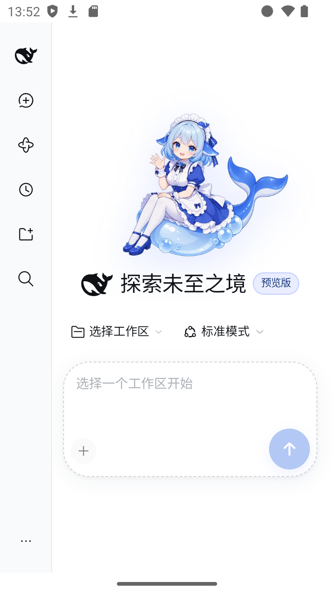
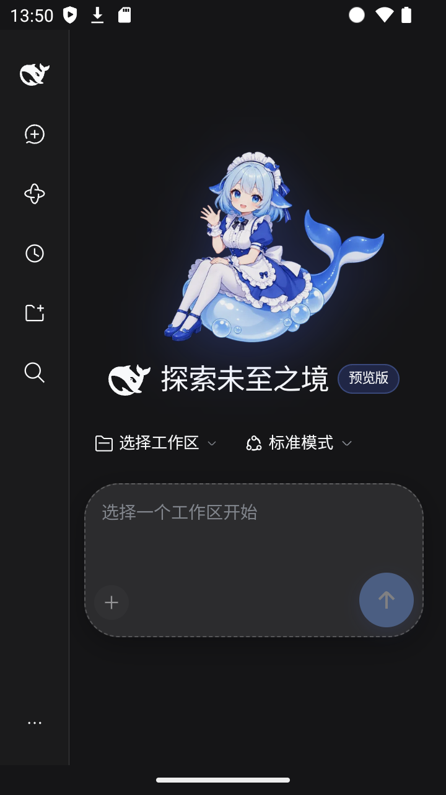
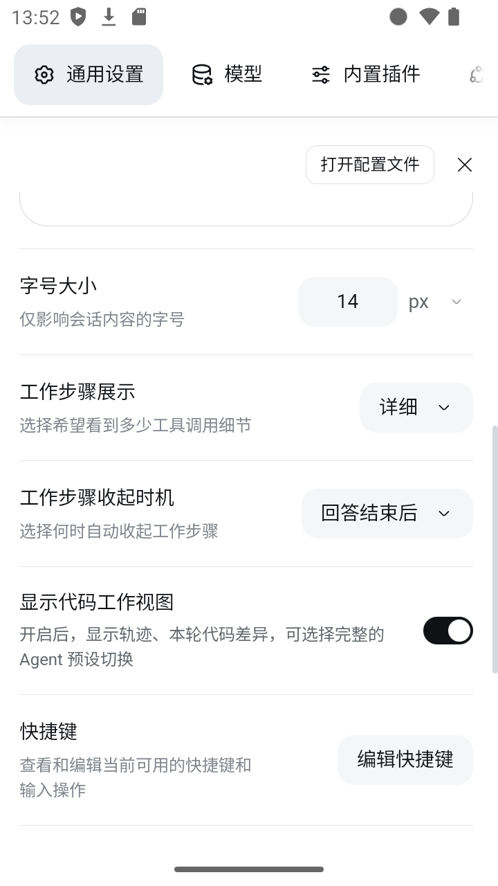

# deepseek harness-Android

蓝色鲸鱼娘主题的 DSH Android 移动端定制版本。首页、启动页和文件空白状态使用蓝白女仆装角色插画，提供无顶栏沉浸式体验、全面栈式返回、手势侧栏抽屉与流畅度深度优化。

[下载 APK](https://github.com/shuoshuochen44-commits/deepseek-harness-Android/releases/latest) · [版本说明](docs/更新日志.md) · [真机验证](docs/真机验证.md) · [构建与测试](docs/构建与测试.md)

## 安装

1. 在 Releases 按设备架构下载对应安装包：
   - **安卓手机（推荐）**：`DeepSeek-Harness-Android-v0.2.4.apk`（`arm64-v8a`）
   - **电脑 Windows ApkStart 运行器**：`DeepSeek-Harness-Android-v0.2.4-x86_64-ApkStart.apk`（`x86_64`，含旧版 WebView 兼容补丁）
2. 允许本次安装后打开应用。首次运行需要解压内置运行时，请等待启动完成。
3. 在设置中配置自己的模型服务或登录账号。应用不附带 API 密钥。

系统要求：Android 8.0 及以上，64 位 ARM（`arm64-v8a`）真机或 `x86_64` 安卓模拟器/ApkStart。当前版本：`0.2.4-mobile`，包名 `io.dsh.android`。

## 页面预览

| 浅色首页（无顶栏沉浸） | 深色首页（无顶栏沉浸） | 设置页 |
| --- | --- | --- |
|  |  |  |

## 本版改进（v0.2.4）

- **无顶栏沉浸式全屏**：取消原顶部黑色 `DeepSeek` 横栏，顶部状态栏与底部导航栏底色及图标颜色随网页浅色/深色主题实时同步。
- **全面栈式返回逻辑**：修复点开「选择工作区目录」、弹出菜单、新建文件夹或二级弹窗时按返回键直接退回桌面的问题，现按最顶层优先逐级返回。
- **蓝色鲸鱼娘视觉打磨**：插画柔光投影与悬浮微动效、冰蓝「预览版」胶囊、圆角侧栏抽屉与毛玻璃遮罩、设置页横向胶囊标签渐隐与自动居中、工作目录选择器移动端重排。
- **手势与流畅度优化**：左侧栏支持 60fps 跟手左滑收起与左边缘右滑呼出；深海蓝渐变启动页与 220ms 交叉淡入转场；流式输出 DOM 监控叶子节点 O(1) 剪枝；`NodeRuntime` 条件通知唤醒。
- **跨环境支持**：同步提供 `arm64-v8a` 真机包与 `x86_64` 电脑 `ApkStart` 专用包。

## 源码范围与验证

本仓库提供这次移动端优化的源码、资源和构建脚本补丁，需要与对应版本的原 DSH Android 工程配合使用；不是包含全部运行时依赖的独立源码工程。可直接使用 Releases 中的完整 APK。

40 项 Playwright 前端与导航自动化测试全部通过；已在 Android 14（ApkStart `x86_64` 环境）实机验证无顶栏沉浸明暗切换、工作目录/菜单/弹窗逐级返回、侧栏圆角抽屉及滑动手势。

## 维护

维护者：[@shuoshuochen44-commits](https://github.com/shuoshuochen44-commits)。仓库公开供查看和下载，原仓库的提交与发布权限由维护者管理，未添加其他协作者。

这是非官方 Android 定制发布；DeepSeek / DSH 品牌、官方图标与运行时的权利归原权利人。插画为本次定制生成，提示词见[素材说明](docs/素材说明.md)。
